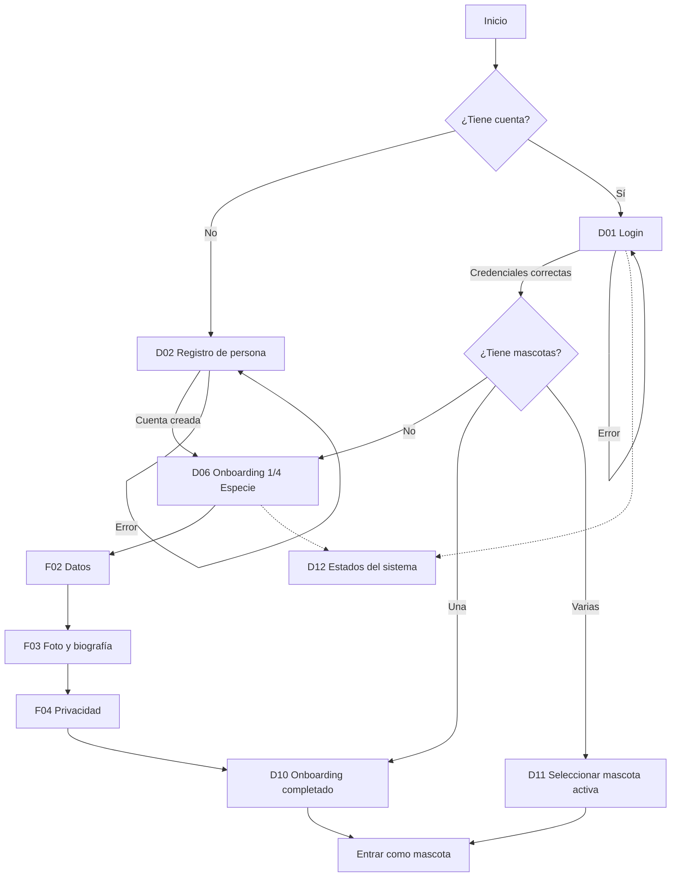

# Flujo — Auth y onboarding

Documento de referencia para los wireframes de autenticación y onboarding.
Complementa el [índice de wireframes](../README.md) y el
[sistema de componentes](../../design-system/07-componentes.md).

La verificación de correo, la recuperación y el restablecimiento de contraseña quedaron fuera
del alcance del producto. Los tableros D03, D04 y D05 se retiraron.

## Diagrama

## Recorrido principal

1. La persona llega a **D01 Login** o **D02 Registro**.
2. Si se registra, entra directamente al onboarding de su primera mascota:
   - **D06** elige especie.
   - **D07** captura nombre, usuario, raza, sexo y fecha.
   - **D08** sube foto y biografía (opcionales).
   - **D09** decide si el perfil es público o privado.
3. **D10** confirma que la mascota ya tiene su espacio.
4. Si la persona ya tenía mascotas, **D11** le permite elegir con cuál entrar.
5. Entra a la aplicación como la mascota seleccionada.

## Pantallas

| ID | Ruta propuesta | Objetivo | Acción principal | Estados |
|---|---|---|---|---|
| D01 | `/entrar` | Autenticar a la persona | Entrar | Default, carga |
| D01b | `/entrar` | Mostrar error de credenciales | Corregir e intentar de nuevo | Error de credenciales |
| D02 | `/crear-cuenta` | Crear la cuenta de persona | Crear cuenta | Default, carga |
| D02b | `/crear-cuenta` | Mostrar errores de validación | Corregir y crear cuenta | Error de validación |
| D06 | `/onboarding/especie` | Elegir especie | Continuar | Default |
| D07 | `/onboarding/datos` | Capturar datos de la mascota | Continuar | Default, error |
| D08 | `/onboarding/perfil` | Foto y biografía | Continuar / Omitir | Default, archivo inválido |
| D09 | `/onboarding/privacidad` | Elegir visibilidad | Terminar | Default |
| D10 | `/onboarding/listo` | Celebrar y entrar | Entrar a PawSpace | Default |
| D11 | `/elegir-mascota` | Elegir mascota activa | Entrar como {nombre} | Una, varias, vacío |
| D12 | — | Comunicar estados del sistema | Reintentar / Entrar | Carga, red, sesión, desactivada |

> Los IDs D03, D04 y D05 quedan retirados y no se reutilizan para no romper referencias.

## Reglas de navegación

- El onboarding no se puede saltar: si la persona no tiene mascotas, no entra al producto.
- Se puede volver a un paso anterior; no se puede avanzar sin completar los campos
  obligatorios (especie, nombre y nombre de usuario).
- La foto, la biografía, la raza, el sexo y la fecha son opcionales.
- No hay verificación de correo, recuperación ni restablecimiento de contraseña en este alcance.
- El correo se valida en formato y se usa como identificador de la cuenta.
- Si la sesión expira, se muestra **D12** con la acción “Entrar de nuevo” y se conserva la
  intención de volver a la pantalla anterior.
- Si la persona tiene una sola mascota y ya está activa, **D11** se omite.
- Si tiene varias, **D11** aparece después del login y después de crear una nueva mascota.
- El cambio de mascota activa vuelve a **D11** sin cerrar la sesión de la persona.

## Casos límite

| Caso | Comportamiento |
|---|---|
| Correo ya registrado | Mensaje genérico y enlace a iniciar sesión. |
| Credenciales incorrectas | Error en D01b; no revela si el correo existe. |
| Nombre de usuario ocupado | Error en D07, sin perder los demás campos. |
| Archivo demasiado grande | Error en D08; se conserva el resto del formulario. |
| Sin conexión | Estado D12; los datos del formulario se conservan en memoria. |
| Cuenta desactivada | Estado D12 con contacto de soporte. |
| Persona con varias mascotas | D11 después del login. |
| Persona sin mascotas | Onboarding obligatorio. |
| Mascota privada | Se muestra la opción en D09; el perfil no aparece en búsquedas. |

## Decisiones de UX

- **Una decisión por paso.** El onboarding separa especie, datos, perfil y privacidad.
- **Progreso visible.** El stepper muestra 4 pasos en escritorio; en móvil, “Paso 2 de 4” y
  una barra.
- **Opcionales explícitos.** Todo lo que no es obligatorio se marca como “(opcional)”.
- **Sin pasos intermedios.** Al registrarse, la persona pasa directo al onboarding.
- **Sin sorpresas.** La privacidad se elige antes de terminar, no después.
- **La mascota es la protagonista.** Los mensajes de éxito usan su nombre, no “tu cuenta”.
- **Errores accionables.** Cada error dice qué pasó y cómo resolverlo.
- **Nada se pierde.** Ante un error de red, el formulario conserva lo escrito.
