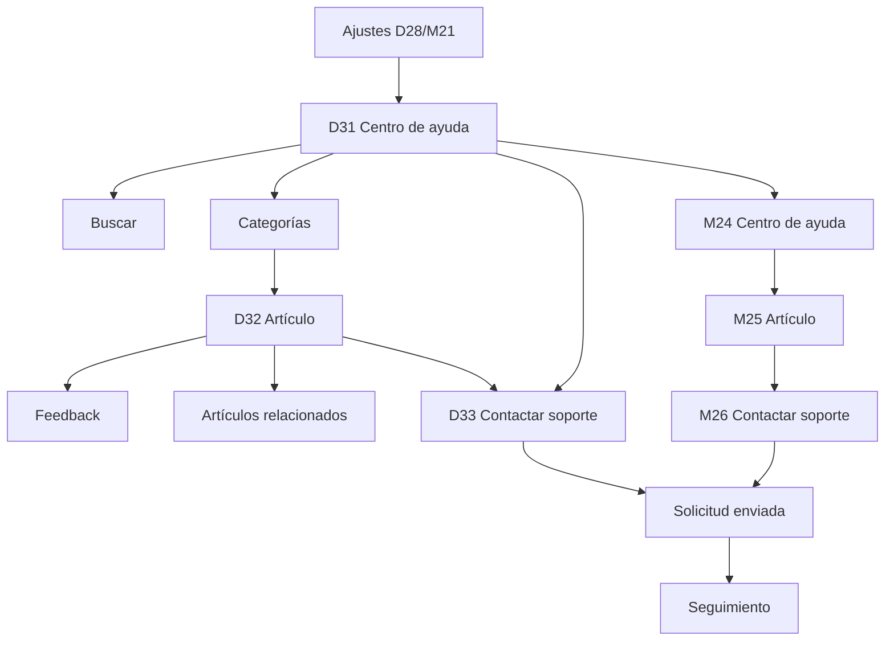

# Flujo — Ayuda y soporte

Documento de referencia para los wireframes del centro de ayuda, los artículos y el contacto con
soporte. Complementa el [índice de wireframes](../README.md) y el
[sistema de componentes](../../design-system/07-componentes.md).

## Objetivo

Validar cómo la persona usuaria resuelve una duda por su cuenta y, si no puede, contacta con
soporte con el contexto necesario. La ayuda debe ser rápida de escanear y el formulario debe pedir
solo lo imprescindible. No define color final ni tono editorial definitivo.

## Flujo

## Pantallas

| ID | Ruta propuesta | Objetivo | Acción principal | Estados |
|---|---|---|---|---|
| D31 | `/ayuda` | Encontrar una respuesta | Buscar | Default, sin resultados |
| D32 | `/ayuda/:slug` | Resolver una duda concreta | Contactar si persiste | Artículo, feedback |
| D33 | `/soporte` | Enviar una solicitud | Enviar solicitud | Formulario, error, enviado |
| M24 | `/ayuda` | Encontrar una respuesta en móvil | Buscar | Default, sin resultados |
| M25 | `/ayuda/:slug` | Resolver una duda en móvil | Contactar si persiste | Artículo, feedback |
| M26 | `/soporte` | Enviar una solicitud en móvil | Enviar solicitud | Formulario, error, enviado |

## Navegación

### Escritorio

- La sidebar marca **Perfil** como activo; la ayuda es una vista de la cuenta.
- El topbar mantiene la búsqueda global y la mascota activa.
- D31 agrupa buscador, temas populares, categorías y preguntas frecuentes.
- D32 muestra breadcrumb, artículo, índice lateral y relacionados.
- D33 mantiene el formulario en el centro y el contexto en el riel derecho.
- El enlace de soporte aparece al final del artículo y en el centro de ayuda.

### Móvil

- Las tres pantallas usan un header con volver y título corto.
- No se muestra bottom nav: son vistas anidadas de ayuda.
- El buscador y las categorías se apilan en una columna.
- El artículo elimina el índice lateral y muestra el contenido completo.
- El formulario ocupa el ancho y el botón de envío queda al final.
- El volver regresa al centro de ayuda sin perder la búsqueda.

## Reglas de interacción

- La búsqueda se ejecuta con Enter o con el botón Buscar.
- La consulta mínima es de 2 caracteres; por debajo se muestra una ayuda.
- Los resultados se agrupan en artículos, categorías y preguntas.
- Una búsqueda sin resultados ofrece categorías y contacto.
- Las categorías y preguntas frecuentes enlazan al artículo.
- El índice lateral resalta la sección visible al hacer scroll.
- El feedback Sí/No se guarda sin recargar y agradece la respuesta.
- Los artículos relacionados se abren en la misma vista.
- El formulario valida tema, correo, asunto, descripción y privacidad.
- El adjunto es opcional y se puede quitar antes de enviar.
- Guardar borrador conserva los datos en el dispositivo.
- Al enviar se muestra el número de solicitud y el plazo de 48 horas.
- El historial de solicitudes muestra el estado y el último movimiento.
- Las solicitudes cerradas se pueden reabrir durante 30 días.

## Casos límite

| Caso | Comportamiento |
|---|---|
| Búsqueda sin resultados | Sugerencias, categorías y enlace a soporte. |
| Artículo desactualizado | Aviso de versión y enlace al artículo vigente. |
| Artículo eliminado | Redirige al centro con un aviso. |
| Enlace profundo a sección | Abre el artículo y hace scroll a la sección. |
| Feedback ya enviado | Se muestra el estado y no se permite duplicar. |
| Formulario incompleto | Errores junto a los campos y envío bloqueado. |
| Adjunto demasiado grande | Error junto al archivo y opción de sustituirlo. |
| Envío fallido | Se conserva el contenido y se ofrece reintentar. |
| Sin conexión | Se guarda como borrador local y se avisa. |
| Solicitud cerrada | Se puede reabrir dentro del plazo. |
| Cuenta eliminada | El formulario se deshabilita y se ofrece el correo de soporte. |
| Estado del servicio degradado | Banner visible con enlace al historial. |

## Componentes implicados

- **CMP-01 Logo**: marca y contexto.
- **CMP-02 Icon**: buscar, chevrons y adjuntos.
- **CMP-03 Avatar**: cuenta en el topbar.
- **CMP-08 Button**: buscar, enviar, reintentar y contactar.
- **CMP-11 FormField**: formulario de soporte.
- **CMP-12 TextInput**: correo y asunto.
- **CMP-14 Textarea**: descripción.
- **CMP-15 Select**: tema de la solicitud.
- **CMP-17 Checkbox**: aceptación de privacidad.
- **CMP-20 FileUpload**: captura adjunta.
- **CMP-21 SearchInput**: búsqueda de ayuda.
- **CMP-25 Alert**: avisos de estado y errores.
- **CMP-26 Toast**: confirmación de envío.
- **CMP-29 EmptyState**: sin resultados.
- **CMP-33 TopBar**: contexto de ayuda.
- **CMP-34 Sidebar**: navegación de escritorio.
- **CMP-70 SearchHero**: buscador principal.
- **CMP-89 HelpCategoryGrid**: categorías.
- **CMP-90 FAQList**: preguntas frecuentes.
- **CMP-91 HelpArticle**: artículo y pasos.
- **CMP-92 SupportForm**: formulario de contacto.
- **CMP-93 SupportTicketList**: solicitudes.
- **CMP-94 SupportStatus**: estado del servicio.

## Decisiones de UX

- **Resolver antes de escribir.** La ayuda prioriza respuestas rápidas.
- **Buscar primero.** El buscador es el punto de entrada principal.
- **Contexto visible.** El artículo mantiene índice y relacionados cerca.
- **Formulario sin fricción.** Solo los campos necesarios y un adjunto opcional.
- **Estado transparente.** El historial muestra qué ocurre con cada solicitud.
- **Móvil directo.** Sin índice lateral ni bottom nav.
- **Sin promesas vacías.** Los tiempos de respuesta son visibles y realistas.
- **Siempre hay salida.** El vacío y el error ofrecen una acción siguiente.

## Mejoras futuras

- Búsqueda con sinónimos y tolerancia a errores.
- Artículos relacionados personalizados por contexto.
- Adjuntar varios archivos y capturas de consola.
- Chat de soporte en vivo.
- Base de conocimiento interna y edición.
- Traducciones de artículos.
- Historial de cambios de cada artículo.
- Encuestas de satisfacción posteriores al cierre.
