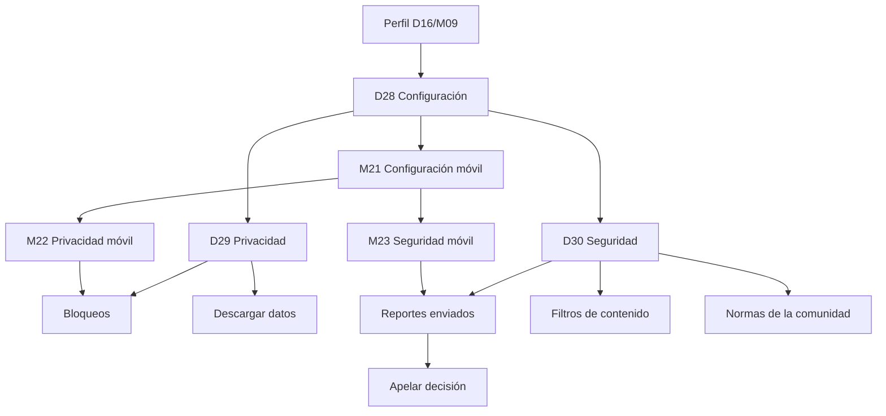

# Flujo — Configuración, privacidad y seguridad

Documento de referencia para los wireframes de cuenta, privacidad, bloqueos y moderación.
Complementa el [índice de wireframes](../README.md) y el
[sistema de componentes](../../design-system/07-componentes.md).

## Objetivo

Validar cómo la persona usuaria controla su cuenta, decide quién ve su contenido y gestiona los
reportes y bloqueos. La configuración debe ser predecible, reversible y explicar el efecto de cada
cambio. No define color final ni microcopy definitivo.

## Flujo

## Pantallas

| ID | Ruta propuesta | Objetivo | Acción principal | Estados |
|---|---|---|---|---|
| D28 | `/ajustes/cuenta` | Editar datos y sesiones | Guardar cambios | Formulario, guardando |
| D29 | `/ajustes/privacidad` | Controlar visibilidad y bloqueos | Guardar permiso | Permisos, bloqueos |
| D30 | `/ajustes/seguridad` | Revisar reportes y filtros | Apelar o ajustar | Reportes, filtros |
| M21 | `/ajustes/cuenta` | Editar la cuenta en móvil | Guardar cambios | Formulario |
| M22 | `/ajustes/privacidad` | Ajustar privacidad en móvil | Guardar permiso | Permisos |
| M23 | `/ajustes/seguridad` | Revisar seguridad en móvil | Apelar o ajustar | Reportes, filtros |

## Navegación

### Escritorio

- La sidebar marca **Perfil** como activo; la configuración es una vista de la cuenta.
- El topbar mantiene la búsqueda global y la mascota activa.
- El control **Cuenta / Privacidad / Seguridad** cambia de sección sin salir de ajustes.
- D28 muestra datos personales, sesiones y ayuda.
- D29 muestra permisos, bloqueos y consejos.
- D30 muestra reportes, filtros y normas.
- El botón de volver del navegador restaura la sección anterior.

### Móvil

- Las tres pantallas comparten el header **Ajustes** con volver.
- El control segmentado ocupa el ancho y repite las tres secciones.
- No se muestra bottom nav: es una vista anidada del perfil.
- Los formularios se apilan en una columna y se guardan al final.
- Los switches se guardan al instante, sin botón adicional.
- El volver regresa al perfil o a la sección anterior de ajustes.

## Reglas de interacción

- Los campos de D28 validan al salir y al guardar.
- Guardar muestra un toast y conserva los valores si falla.
- El correo nuevo valida el formato y se guarda; no hay verificación por correo.
- Cambiar la contraseña pide la actual y cierra las demás sesiones.
- Cerrar una sesión o todas pide confirmación.
- Eliminar la cuenta pide escribir el handle y confirmar en un modal.
- Los permisos de privacidad se guardan al instante.
- Hacer público el perfil pide confirmación explícita.
- Desbloquear una cuenta pide confirmación.
- Los filtros de contenido se aplican al feed sin recargar.
- Un reporte se puede apelar solo si está resuelto o rechazado.
- Los reportes propios no se borran; se archivan tras 90 días.
- Las normas y la política de privacidad abren en una pestaña nueva.

## Casos límite

| Caso | Comportamiento |
|---|---|
| Correo ya registrado | Error en el campo y no se guarda. |
| Contraseña incorrecta | Error en el campo actual y no se cierra la sesión. |
| Sesión desconocida | Se resalta y se ofrece cerrar todas. |
| Cambio de privacidad fallido | El switch revierte y se muestra un aviso. |
| Bloqueo de una cuenta | Se oculta su contenido y se impide el mensaje. |
| Desbloqueo | Se restaura el contenido sin notificar a la otra cuenta. |
| Reporte duplicado | Se informa que ya existe y se enlaza al existente. |
| Reporte sin objetivo | No se permite enviar. |
| Apelación fuera de plazo | Se explica el plazo y se deshabilita la acción. |
| Descarga de datos en curso | Estado de progreso y aviso al terminar. |
| Cuenta con reportes abiertos | Eliminar la cuenta pide confirmación adicional. |
| Sin conexión | Los switches no cambian hasta confirmar; se avisa. |

## Componentes implicados

- **CMP-01 Logo**: marca y avisos de sistema.
- **CMP-02 Icon**: volver, chevrons y estados.
- **CMP-03 Avatar**: cuenta y cuentas bloqueadas.
- **CMP-08 Button**: guardar, descargar, apelar y confirmar.
- **CMP-11 FormField**: datos personales y contraseña.
- **CMP-12 TextInput**: nombre, correo, teléfono y ubicación.
- **CMP-14 Textarea**: biografía.
- **CMP-19 Switch**: permisos y filtros.
- **CMP-25 Alert**: avisos de privacidad y seguridad.
- **CMP-26 Toast**: confirmaciones de guardado.
- **CMP-33 TopBar**: contexto de ajustes.
- **CMP-34 Sidebar**: navegación de escritorio.
- **CMP-36 Modal**: confirmaciones destructivas.
- **CMP-51 NotificationItem**: patrón de fila para reportes.
- **CMP-83 SettingsNav**: Cuenta, Privacidad y Seguridad.
- **CMP-84 SettingsSection**: tarjetas de ajustes.
- **CMP-85 SettingsRow**: filas con switch o enlace.
- **CMP-86 PrivacyControls**: permisos de perfil e historias.
- **CMP-87 BlockedAccounts**: lista y desbloqueo.
- **CMP-88 ReportList**: reportes y estados.

## Decisiones de UX

- **El efecto se explica.** Cada permiso describe qué cambia, no solo el estado.
- **Guardado inmediato.** Los switches no necesitan botón; los formularios sí.
- **Reversible.** Cerrar sesión, desbloquear y cambiar privacidad se pueden deshacer.
- **Peligro separado.** Eliminar la cuenta nunca comparte zona con Guardar.
- **Transparencia en moderación.** El estado y la fecha de cada reporte son visibles.
- **Menos es más.** La configuración se divide en tres secciones claras.
- **Móvil consistente.** Las mismas tres secciones, sin bottom nav.
- **Privacidad por defecto.** Mensajes de desconocidos y ubicación empiezan desactivados.

## Mejoras futuras

- Autenticación con passkeys y códigos de respaldo.
- Historial de actividad y auditoría de seguridad.
- Apelaciones con seguimiento y respuesta del equipo.
- Exportación de datos en formato legible.
- Eliminación programada con periodo de gracia.
- Administración interna de reportes y sanciones.
