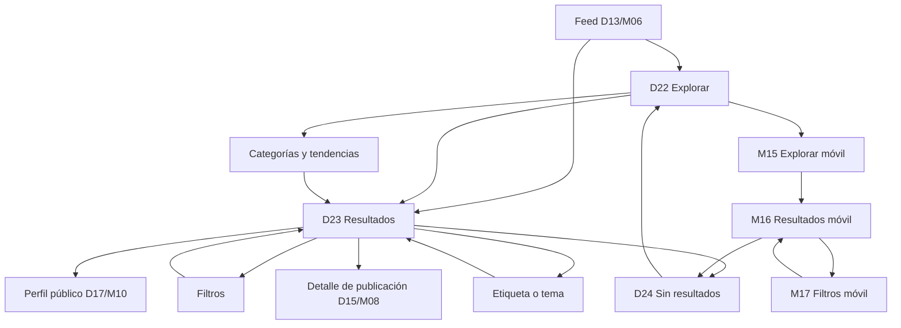

# Flujo — Explorar y búsqueda

Documento de referencia para los wireframes del descubrimiento, los resultados y los filtros.
Complementa el [índice de wireframes](../README.md) y el
[sistema de componentes](../../design-system/07-componentes.md).

## Objetivo

Validar cómo se descubre contenido nuevo y cómo se busca una mascota, publicación o etiqueta.
Explorar es navegación sin intención; buscar es una intención concreta. Ambos comparten el mismo
modelo de resultados y filtros, pero no la misma jerarquía. No define color final ni tipografía.

## Flujo

## Pantallas

| ID | Ruta propuesta | Objetivo | Acción principal | Estados |
|---|---|---|---|---|
| D22 | `/explorar` | Descubrir sin una consulta previa | Buscar | Default, cargando |
| D23 | `/buscar?q=golden%20retriever` | Encontrar coincidencias | Seguir | Resultados, cargando |
| D24 | `/buscar?q=dinosaurio` | Explicar una búsqueda sin resultados | Limpiar filtros | Vacío, error |
| M15 | `/explorar` | Descubrir en móvil | Buscar | Default, cargando |
| M16 | `/buscar?q=golden%20retriever` | Encontrar coincidencias en móvil | Seguir | Resultados, cargando |
| M17 | `/buscar?filtros=abierto` | Refinar la búsqueda en móvil | Aplicar filtros | Hoja abierta |

## Navegación

### Escritorio

- La sidebar marca **Explorar** como activo en D22, D23 y D24.
- El topbar conserva la búsqueda y la tarjeta de mascota activa.
- D22 es el punto de entrada sin consulta; D23 y D24 siempre muestran una consulta.
- El panel de filtros vive en el riel derecho de resultados.
- Los resultados enlazan al perfil público o al detalle de publicación.
- Las tendencias y categorías vuelven a resultados con la consulta aplicada.
- Cerrar una etiqueta o tema regresa a la búsqueda anterior.

### Móvil

- La bottom nav marca **Explorar** como activo en M15 y M16.
- M17 es una hoja modal sobre resultados; la bottom nav queda cubierta por el overlay.
- El buscador móvil ocupa el ancho completo bajo el header.
- Los filtros se abren desde el chip **Filtros** y se aplican desde el footer sticky.
- Los resultados mantienen la consulta al abrir y cerrar la hoja.

## Reglas de interacción

- La búsqueda se dispara con Enter o al pulsar Buscar; no en cada tecla.
- La consulta mínima es de 2 caracteres; por debajo se muestra una ayuda, no resultados.
- La URL refleja `q`, pestaña y filtros para que el enlace sea compartible.
- Volver atrás restaura consulta, pestaña y filtros.
- Los resultados se agrupan por tipo: mascotas, publicaciones y etiquetas.
- La pestaña **Todo** mezcla tipos y prioriza mascotas verificadas y coincidencias exactas.
- Los filtros se aplican en caliente; **Aplicar** cierra la hoja móvil y actualiza el conteo.
- Los filtros activos se muestran como chips removibles y se pueden limpiar en bloque.
- **Seguir** es optimista y revierte si falla.
- La paginación es incremental; el final de la lista carga la siguiente página.
- Las búsquedas recientes se guardan localmente y se pueden borrar.
- Las tendencias se calculan en una ventana de 24 horas.
- Una búsqueda sin resultados conserva la consulta y ofrece alternativas.
- Un error de red mantiene la consulta y ofrece reintentar.
- Los perfiles privados o bloqueados no exponen contenido en los resultados.

## Casos límite

| Caso | Comportamiento |
|---|---|
| Consulta de 0–1 caracteres | Ayuda breve; no se ejecuta la búsqueda. |
| Sin resultados | D24 con sugerencias, filtros activos y acciones. |
| Sin resultados por filtros | Ofrece limpiar filtros antes que cambiar la consulta. |
| Error de red | Estado de error con reintentar y conservar la consulta. |
| Búsqueda lenta | Skeletons en la lista; no se bloquea el campo. |
| Perfil privado | Tarjeta con contenido bloqueado y acción de seguir. |
| Perfil bloqueado | Tarjeta mínima con opción de desbloquear. |
| Etiqueta inexistente | Resultados vacíos con etiquetas relacionadas. |
| Filtro sin coincidencias | Conteo en cero y botón Aplicar deshabilitado. |
| Historia de búsqueda vacía | Solo se muestran populares y relacionadas. |
| Enlace compartido | Restaura consulta, pestaña y filtros desde la URL. |
| Sin conexión | Últimos resultados en caché con aviso y reintento. |

## Componentes implicados

- **CMP-01 Logo**: sidebar y marca.
- **CMP-02 Icon**: búsqueda, limpiar, flechas y estados.
- **CMP-03 Avatar**: mascotas en resultados.
- **CMP-08 Button**: buscar, seguir, aplicar y limpiar.
- **CMP-09 IconButton**: cerrar la hoja de filtros.
- **CMP-11 FormField**: etiquetas de filtros.
- **CMP-12 TextInput**: consulta y ubicación.
- **CMP-15 Select**: raza y orden.
- **CMP-19 Switch**: solo verificados.
- **CMP-21 SearchInput**: campo de búsqueda global y móvil.
- **CMP-29 EmptyState**: base del estado sin resultados.
- **CMP-31 Tabs**: Todo, Mascotas, Publicaciones y Etiquetas.
- **CMP-33 TopBar**: título, búsqueda y mascota activa.
- **CMP-34 Sidebar**: navegación de escritorio.
- **CMP-40 PetAvatar**: avatar de resultados.
- **CMP-41 PetCard**: tarjetas de descubrimiento.
- **CMP-55 BottomNav**: navegación móvil.
- **CMP-70 SearchHero**: entrada de búsqueda de D22.
- **CMP-71 SearchResults**: resumen, tabs y lista.
- **CMP-72 FilterPanel**: panel de escritorio y hoja móvil.
- **CMP-73 PetResultCard**: resultado de mascota.
- **CMP-74 TrendingList**: tendencias y búsquedas populares.
- **CMP-75 SearchEmpty**: estado sin resultados.
- **CMP-76 SearchSuggestions**: recientes, populares y relacionadas.

## Decisiones de UX

- **Descubrir y buscar son distintos.** Explorar inspira; buscar responde.
- **Una acción principal.** Buscar en explorar; seguir en resultados.
- **La consulta nunca se pierde.** URL, pestaña y filtros sobreviven a la navegación.
- **Filtros visibles.** El usuario ve qué está aplicado y puede quitarlo.
- **Resultados mixtos.** Todo mezcla tipos; las pestañas permiten enfocar.
- **Sin callejones sin salida.** El vacío siempre ofrece una alternativa.
- **Móvil sin sorpresas.** La hoja de filtros no cambia el contexto de resultados.
- **Rendimiento percibido.** Skeletons y paginación incremental en lugar de bloqueos.

## Mejoras futuras

- Búsqueda por voz y cámara.
- Filtros guardados y alertas de nuevas coincidencias.
- Búsqueda por ubicación con mapa.
- Historial de búsquedas sincronizado entre dispositivos.
- Resultados de etiquetas con portada y seguidores.
- Orden personalizado y recomendaciones por afinidad.
- Moderación y reporte desde resultados.
