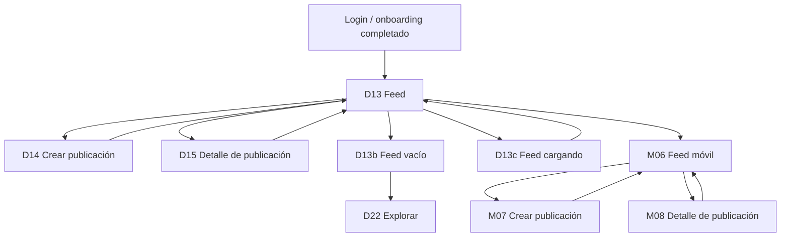

# Flujo — Feed y navegación

Documento de referencia para los wireframes del feed principal. Complementa el
[índice de wireframes](../README.md) y el
[sistema de componentes](../../design-system/07-componentes.md).

## Objetivo

Validar la estructura del feed, la navegación principal y el primer ciclo de publicación:
entrar, leer, crear y comentar. No define color, tipografía final ni ilustración.

## Flujo

## Pantallas

| ID | Ruta propuesta | Objetivo | Acción principal | Estados |
|---|---|---|---|---|
| D13 | `/inicio` | Leer el feed de mascotas | Crear publicación | Default |
| D13b | `/inicio` | Explicar un feed sin contenido | Explorar mascotas | Vacío |
| D13c | `/inicio` | anticipar la carga del feed | — | Cargando |
| D14 | `/publicar` | Crear una publicación | Publicar | Compositor |
| D15 | `/publicacion/:id` | Leer una publicación y sus comentarios | Comentar | Default |
| M06 | `/inicio` | Leer el feed en móvil | Crear publicación | Default |
| M07 | `/publicar` | Crear una publicación en móvil | Publicar | Compositor |
| M08 | `/publicacion/:id` | Leer y comentar en móvil | Enviar comentario | Default |

## Navegación

### Escritorio

- **Sidebar fija** con Inicio, Explorar, Notificaciones, Mensajes y Perfil.
- El estado activo se marca con fondo suave, texto en negrita e icono oscuro.
- **Crear publicación** es la acción principal y permanece visible en la sidebar.
- La mascota activa aparece en la sidebar y en la tarjeta superior del riel derecho.
- **Cambiar** lleva a D11 para elegir otra mascota sin cerrar la sesión.
- El riel derecho contiene sugerencias y tendencias; no compite con el feed.
- La búsqueda del topbar abre los resultados documentados en [flujo-explorar.md](flujo-explorar.md).

### Móvil

- **Bottom navigation** con Inicio, Explorar, Crear, Avisos y Perfil.
- **Crear** ocupa el centro y usa un botón circular para destacar la acción.
- El feed conserva las historias, las pestañas Para ti / Siguiendo y el compositor.
- El detalle mantiene el botón de volver y el compositor de comentarios fijo abajo.
- La publicación se escribe a pantalla completa, sin modal.

## Reglas de interacción

- La acción **Crear publicación** abre D14 en escritorio y M07 en móvil.
- Publicar vuelve al feed y coloca la publicación nueva al inicio.
- Un clic en el cuerpo o en la imagen de una publicación abre D15/M08.
- Volver desde el detalle conserva la posición de scroll del feed.
- El compositor conserva el texto si falla la red; el error se muestra sin perder lo escrito.
- El feed vacío solo aparece cuando la persona no sigue a nadie y no tiene publicaciones.
- El estado de carga usa skeletons, no un spinner de pantalla completa.
- El anillo de historia abre el visor documentado en [flujo-historias.md](flujo-historias.md).
- Las sugerencias y tendencias son informativas en esta fase; sus acciones se conectan después.

## Casos límite

| Caso | Comportamiento |
|---|---|
| Sin publicaciones | D13b con acción para explorar mascotas. |
| Carga inicial lenta | D13c con skeletons de publicación. |
| Error de red | D12; el feed conserva el contenido ya cargado. |
| Sesión expirada | D12 con acción para volver a entrar. |
| Publicación eliminada | Se muestra un estado vacío dentro de D15. |
| Comentario vacío | El botón Enviar permanece deshabilitado. |
| Imagen demasiado grande | Error en el compositor; el texto se conserva. |
| Perfil privado | La publicación no aparece en el feed público. |
| Mascota con varias cuentas | Cambiar desde la sidebar o desde la tarjeta de mascota activa. |

## Componentes implicados

- **CMP-33 TopBar**: búsqueda, título y acciones de contexto.
- **CMP-34 Sidebar**: navegación principal y mascota activa.
- **CMP-48 PostCard**: autor, texto, media, acciones y contadores.
- **CMP-49 CommentItem**: avatar, autor, tiempo y texto.
- **CMP-50 StoryRing**: anillo de historia y estado propio.
- **CMP-53 Composer**: texto, media, contador y publicación.
- **CMP-54 FeedTabs**: Para ti / Siguiendo en móvil.
- **CMP-55 BottomNav**: navegación móvil con acción central.

## Decisiones de UX

- **Una acción principal por pantalla.** En el feed es crear; en el detalle es comentar.
- **Lectura primero.** El contenido ocupa el centro; las sugerencias quedan en un riel.
- **La mascota es la protagonista.** El feed habla de Luna y de otras mascotas, no de la cuenta.
- **Estados explícitos.** Vacío, carga y error tienen una representación propia.
- **Sin sorpresas.** Publicar y comentar muestran el resultado en el mismo contexto.
- **Navegación estable.** La sidebar y la bottom nav no cambian de posición entre pantallas.

## Mejoras futuras

- Gestión avanzada de mascotas: razas, historial y logros.
- Paginación o carga incremental del feed.
- Moderación de publicaciones y comentarios.
