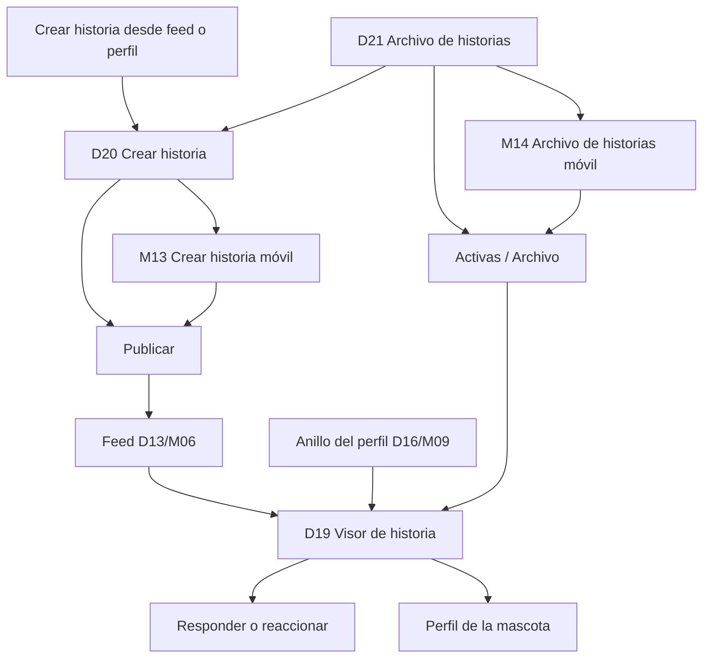

# Flujo — Historias

Documento de referencia para los wireframes del visor, la creación y el archivo de historias.
Complementa el [índice de wireframes](../README.md) y el
[sistema de componentes](../../design-system/07-componentes.md).

## Objetivo

Validar cómo se consumen, crean y conservan las historias de 24 horas. La historia es contenido
efímero y vertical; su valor está en la rapidez del visor y en la claridad del compositor. No
define color final, tipografía ni edición avanzada de imagen.

## Flujo

## Pantallas

| ID | Ruta propuesta | Objetivo | Acción principal | Estados |
|---|---|---|---|---|
| D19 | `/historias/:handle` | Consumir historias sin salir del contexto | Responder | Default, pausa, carga, error |
| D20 | `/historias/crear` | Publicar una historia | Publicar | Vacío, subiendo, error |
| D21 | `/perfil/historias` | Gestionar activas y archivadas | Crear historia | Activas, archivo, vacío |
| M12 | `/historias/:handle` | Consumir historias en móvil | Responder | Default, pausa, carga, error |
| M13 | `/historias/crear` | Publicar una historia en móvil | Publicar | Vacío, subiendo, error |
| M14 | `/perfil/historias` | Gestionar historias en móvil | Crear historia | Activas, archivo, vacío |

## Navegación

### Escritorio

- D19 es un overlay oscuro sin sidebar ni topbar; el foco queda atrapado en el visor.
- D20 conserva la sidebar con **Inicio** activo y el topbar de creación.
- D21 conserva la sidebar con **Perfil** activo; el archivo es una vista del perfil.
- El visor avanza con flechas laterales, teclado y clic en las zonas izquierda/derecha.
- Cerrar el visor devuelve al feed, al perfil o al archivo según el punto de entrada.
- El compositor se abre desde el feed, el anillo propio o el archivo.
- El archivo enlaza de vuelta al visor y al compositor.

### Móvil

- M12 ocupa toda la pantalla y oculta la bottom nav.
- M13 usa un topbar de creación con cerrar y publicar; no muestra bottom nav.
- M14 conserva la bottom nav con **Perfil** activo.
- En M12, tocar el borde izquierdo retrocede y el derecho avanza; mantener pulsado pausa.
- El compositor móvil apila previsualización y controles en una sola columna.
- El archivo móvil usa dos columnas y un botón fijo para crear.

## Reglas de interacción

- Una historia vive 24 horas desde su publicación y después pasa al archivo propio.
- El visor agrupa las historias de una mascota y avanza automáticamente por segmentos.
- Mantener pulsado pausa la reproducción; soltar reanuda donde estaba.
- Al llegar al final de una mascota se pasa a la siguiente; al terminar todas, se cierra.
- Las historias vistas se recuerdan durante la sesión y se muestran atenuadas.
- Responder abre el mensaje directo con el contexto de la historia.
- El me gusta es optimista y se confirma con una animación breve.
- El compositor exige un medio; el texto es opcional.
- La audiencia se elige antes de publicar y se muestra en el archivo.
- Desactivar respuestas oculta la barra en el visor y avisa al creador.
- Publicar vuelve al feed y coloca la historia propia al inicio del anillo.
- Eliminar una historia pide confirmación y la quita del visor y del archivo.
- Las historias archivadas no reaparecen en el anillo ni en el visor público.
- El orden del archivo es por fecha descendente, agrupado por mes.

## Casos límite

| Caso | Comportamiento |
|---|---|
| Sin historias activas | El anillo no se muestra; el archivo explica el estado vacío. |
| Historia expirada abierta | Se muestra un aviso y se pasa a la siguiente disponible. |
| Medio lento | Se mantiene el marco con spinner y se precarga la siguiente. |
| Medio fallido | Se ofrece reintentar o pasar a la siguiente historia. |
| Respuestas desactivadas | La barra de respuesta desaparece y se informa al usuario. |
| Audiencia solo seguidores | El visor público exige seguir para ver el contenido. |
| Historia eliminada | Desaparece del visor y del archivo sin recargar. |
| Subida cancelada | Se descarta el borrador y se vuelve al punto de origen. |
| Subida fallida | El borrador se conserva y se permite reintentar. |
| Archivo vacío | Estado vacío con acción para crear la primera historia. |
| Varias historias propias | Se agrupan en un solo anillo y se ordenan por publicación. |
| Sin conexión | El visor muestra el último contenido en caché y avisa. |

## Componentes implicados

- **CMP-01 Logo**: marca en el compositor y el archivo.
- **CMP-02 Icon**: cerrar, flechas, me gusta, más y estados.
- **CMP-03 Avatar**: autor de la historia y respuestas.
- **CMP-08 Button**: publicar, reintentar y crear historia.
- **CMP-11 FormField**: texto superpuesto y errores.
- **CMP-12 TextInput**: texto de la historia.
- **CMP-15 Select**: audiencia.
- **CMP-19 Switch**: permitir respuestas.
- **CMP-20 FileUpload**: selección de imagen o vídeo.
- **CMP-33 TopBar**: contexto del compositor.
- **CMP-34 Sidebar**: navegación en D20 y D21.
- **CMP-40 PetAvatar**: autor dentro del visor.
- **CMP-50 StoryRing**: punto de entrada desde feed y perfil.
- **CMP-55 BottomNav**: navegación en M14.
- **CMP-57 ProfileTabs**: acceso al archivo desde el perfil.
- **CMP-64 StoryViewer**: overlay y reproducción.
- **CMP-65 StoryProgress**: segmentos y avance.
- **CMP-66 StoryComposer**: creación y publicación.
- **CMP-67 StoryCard**: tarjeta de historia en el archivo.
- **CMP-68 StoryReplyBar**: respuesta y reacción.
- **CMP-69 StoryArchive**: activas, archivo y resumen.

## Decisiones de UX

- **El contenido manda.** El visor ocupa la pantalla y elimina todo lo que distraiga.
- **Un solo gesto principal.** Tocar avanza; mantener pulsado pausa.
- **Crear sin fricción.** Un medio, texto opcional y publicar.
- **Privacidad visible.** La audiencia y las respuestas se eligen antes de publicar.
- **Lo efímero se entiende.** El tiempo restante y el archivo explican qué desaparece.
- **El archivo es del creador.** Solo el perfil propio gestiona activas y archivadas.
- **Continuidad.** Cerrar el visor devuelve exactamente al punto de entrada.
- **Sin callejones sin salida.** Todo error ofrece reintentar o volver.

## Mejoras futuras

- Editor de texto, stickers y dibujo sobre la historia.
- Música, filtros y recorte avanzado.
- Menciones y enlaces dentro de la historia.
- Lista de vistas y reacciones por historia.
- Destacadas en el perfil público.
- Respuestas como hilo de mensajería completa.
- Descarga y compartir una historia archivada.
