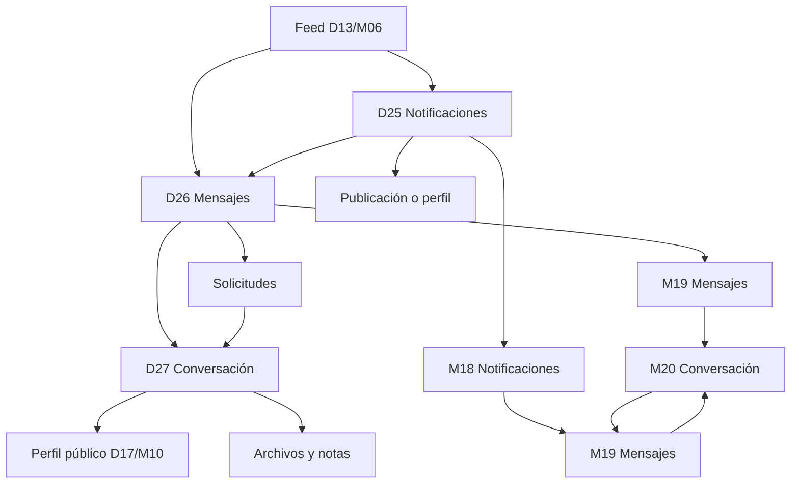

# Flujo — Notificaciones y mensajería

Documento de referencia para los wireframes de avisos, bandeja de entrada y conversación.
Complementa el [índice de wireframes](../README.md) y el
[sistema de componentes](../../design-system/07-componentes.md).

## Objetivo

Validar cómo se enteran las personas de la actividad de su mascota y cómo conversan con otras.
Las notificaciones son un resumen accionable; la mensajería es una conversación con identidad,
contexto y privacidad. No define color final ni adornos visuales.

## Flujo

## Pantallas

| ID | Ruta propuesta | Objetivo | Acción principal | Estados |
|---|---|---|---|---|
| D25 | `/notificaciones` | Revisar la actividad reciente | Abrir aviso | Lista, vacío, cargando |
| D26 | `/mensajes` | Elegir una conversación | Abrir conversación | Bandeja, búsqueda, solicitudes |
| D27 | `/mensajes/:handle` | Conversar con una mascota | Enviar mensaje | Hilo, adjunto, error |
| M18 | `/avisos` | Revisar avisos en móvil | Abrir aviso | Lista, vacío |
| M19 | `/avisos/mensajes` | Elegir conversación en móvil | Abrir conversación | Bandeja, búsqueda |
| M20 | `/mensajes/:handle` | Conversar en móvil | Enviar mensaje | Hilo, adjunto, error |

## Navegación

### Escritorio

- La sidebar marca **Notificaciones** en D25 y **Mensajes** en D26 y D27.
- D25 y D26 conservan el topbar con búsqueda global y mascota activa.
- D27 mantiene la sidebar y el topbar, con el hilo como contenido principal.
- El aviso abre la publicación, el perfil o la conversación correspondiente.
- La conversación seleccionada en D26 se abre en D27.
- El riel derecho de D25 contiene resumen, preferencias y sugerencias.
- El riel derecho de D26 contiene la conversación seleccionada, solicitudes y sugerencias.
- El riel derecho de D27 contiene perfil, archivos compartidos y notas.

### Móvil

- En móvil, **Avisos** agrupa notificaciones y mensajes en una sola sección.
- M18 y M19 usan un control segmentado **Notificaciones / Mensajes**.
- La bottom nav marca **Avisos** como activo en M18 y M19.
- M20 ocupa toda la pantalla y oculta la bottom nav; el volver regresa a M19.
- La hoja de detalles de la conversación se abre desde el menú de M20.
- El compositor queda fijo sobre el área segura inferior.

## Reglas de interacción

- Las notificaciones se agrupan por Hoy, Ayer y Anteriores.
- Abrir una notificación la marca como leída y navega a su destino.
- **Marcar todo leído** es optimista y revierte si falla.
- El contador de no leídas se actualiza sin recargar.
- Las preferencias se guardan al instante y aplican a toda la cuenta.
- Los mensajes directos no se pueden desactivar por completo.
- La bandeja ordena por actividad reciente y separa solicitudes.
- Aceptar una solicitud crea la conversación y la mueve a Todos.
- Ignorar una solicitud la elimina de la lista sin bloquear a la mascota.
- Enviar es optimista: el mensaje aparece y muestra estado de envío.
- Enter envía; Shift+Enter inserta un salto de línea.
- El hilo hace auto-scroll al último mensaje y carga anteriores al llegar arriba.
- Los adjuntos fallidos se reintentan sin perder el texto.
- Silenciar oculta los avisos de esa conversación, no los mensajes.
- Reportar abre el flujo de moderación y no elimina la conversación.
- Bloquear oculta la conversación y el perfil de la otra mascota.

## Casos límite

| Caso | Comportamiento |
|---|---|
| Sin notificaciones | Estado vacío con acción para explorar. |
| Todas leídas | El contador desaparece y el botón masivo se deshabilita. |
| Aviso de cuenta eliminada | Se muestra como no disponible y no navega. |
| Preferencia desactivada | El aviso no se genera, pero el historial previo se conserva. |
| Sin conversaciones | Estado vacío con acción para buscar mascotas. |
| Solicitud pendiente | Se muestra en su pestaña y no en Todos hasta aceptar. |
| Conversación bloqueada | Se oculta el hilo y se ofrece desbloquear. |
| Mensaje vacío | Enviar deshabilitado. |
| Sin conexión | El mensaje queda en cola con estado pendiente. |
| Adjunto demasiado grande | Error junto al archivo y opción de elegir otro. |
| Conversación sin mensajes | Invitación a escribir el primero. |
| Cuenta eliminada | El hilo muestra un aviso y deshabilita el compositor. |
| Reporte enviado | Confirmación y opción de bloquear. |

## Componentes implicados

- **CMP-01 Logo**: marca y avisos de sistema.
- **CMP-02 Icon**: acciones, estados y adjuntos.
- **CMP-03 Avatar**: personas y mascotas.
- **CMP-08 Button**: abrir, aceptar, enviar y reintentar.
- **CMP-09 IconButton**: volver, adjuntar y menú.
- **CMP-12 TextInput**: búsqueda de conversaciones.
- **CMP-19 Switch**: preferencias.
- **CMP-21 SearchInput**: búsqueda de mensajes.
- **CMP-26 Toast**: confirmaciones de envío y preferencias.
- **CMP-29 EmptyState**: sin notificaciones y sin conversaciones.
- **CMP-31 Tabs**: notificaciones y bandeja.
- **CMP-33 TopBar**: título y contexto.
- **CMP-34 Sidebar**: navegación de escritorio.
- **CMP-40 PetAvatar**: autor de la conversación.
- **CMP-51 NotificationItem**: fila de aviso.
- **CMP-52 MessageBubble**: burbuja del hilo.
- **CMP-55 BottomNav**: navegación móvil.
- **CMP-77 NotificationList**: lista agrupada y tabs.
- **CMP-78 NotificationPreferences**: canales y tipos.
- **CMP-79 ConversationList**: bandeja y solicitudes.
- **CMP-80 ChatThread**: hilo y cabecera.
- **CMP-81 MessageComposer**: entrada y envío.
- **CMP-82 ChatDetails**: perfil, archivos y notas.

## Decisiones de UX

- **Avisos accionables.** Cada notificación lleva a algo concreto.
- **Leído sin ruido.** El estado se entiende por punto y fondo, no solo por negrita.
- **Preferencias inmediatas.** Sin botón Guardar; el cambio se confirma al instante.
- **Conversación con contexto.** El riel muestra quién es la mascota y qué se compartió.
- **Enviar sin miedo.** El mensaje se puede reintentar y el borrador se conserva.
- **Solicitudes separadas.** No se mezclan con conversaciones aceptadas.
- **Móvil simplificado.** Avisos agrupa notificaciones y mensajes sin duplicar la nav.
- **Privacidad explícita.** Silenciar, bloquear y reportar tienen efectos claros.

## Mejoras futuras

- Notificaciones push y permisos del navegador.
- Mensajes de voz y videollamada.
- Búsqueda dentro de la conversación.
- Reacciones a mensajes y respuestas citadas.
- Carpeta de archivados y papelera de conversaciones.
- Programación de mensajes y respuestas rápidas.
- Moderación y apelaciones de bloqueos.
- Sincronización de no leídos entre dispositivos.
