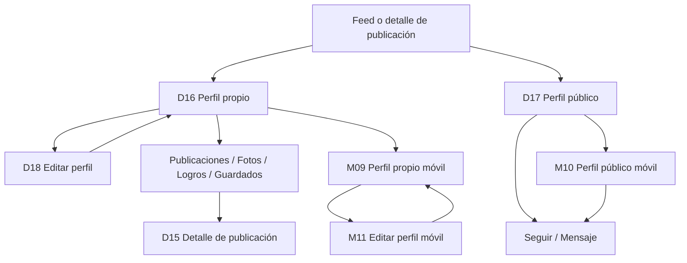

# Flujo — Perfil de mascota

Documento de referencia para los wireframes del perfil propio, el perfil público y la edición
de perfil. Complementa el [índice de wireframes](../README.md) y el
[sistema de componentes](../../design-system/07-componentes.md).

## Objetivo

Validar la identidad de la mascota, su contenido, sus métricas y las acciones de seguimiento y
edición. El perfil es el destino natural de una publicación y el punto de entrada para descubrir
otras mascotas. No define color, tipografía final ni ilustración.

## Flujo

## Pantallas

| ID | Ruta propuesta | Objetivo | Acción principal | Estados |
|---|---|---|---|---|
| D16 | `/perfil` | Ver y gestionar el perfil propio | Editar perfil | Default |
| D17 | `/mascota/:handle` | Conocer a otra mascota | Seguir | Default |
| D18 | `/perfil/editar` | Actualizar identidad y privacidad | Guardar cambios | Formulario |
| M09 | `/perfil` | Ver el perfil propio en móvil | Editar perfil | Default |
| M10 | `/mascota/:handle` | Ver un perfil público en móvil | Seguir | Default |
| M11 | `/perfil/editar` | Editar el perfil en móvil | Guardar cambios | Formulario |

## Navegación

### Escritorio

- La sidebar marca **Perfil** como activo en D16 y D18.
- En D17 no hay elemento activo: el perfil público es contextual y se llega desde el feed o una
  publicación.
- El topbar mantiene la búsqueda y la tarjeta de mascota activa.
- El perfil propio muestra cuatro pestañas; el público, tres.
- **Editar perfil** y **Compartir** son las acciones del perfil propio.
- **Seguir** y **Mensaje** son las acciones del perfil público.
- El menú de tres puntos agrupa compartir, copiar enlace, reportar y bloquear.
- El riel derecho contiene mascotas, información, seguidores sugeridos o verificación según el
  tipo de perfil.

### Móvil

- La bottom nav marca **Perfil** como activo en M09.
- En M10 no hay elemento activo; se mantiene la navegación principal.
- M11 usa un topbar de edición con cerrar y **Guardar**; no muestra bottom nav.
- Las pestañas permiten scroll horizontal si no caben.
- La rejilla usa tres columnas y tarjetas de 114 px.
- El botón de guardado de M11 es sticky al final del formulario.

## Reglas de interacción

- El perfil propio muestra **Editar perfil** y **Compartir**; el público muestra **Seguir** y
  **Mensaje**.
- **Seguir** es optimista: cambia a **Siguiendo** al instante y revierte si falla.
- Un perfil privado muestra el contenido bloqueado y convierte **Seguir** en **Solicitud
  enviada**.
- Las pestañas **Publicaciones**, **Fotos**, **Logros** y **Guardados** conservan su posición
  de scroll.
- **Guardados** solo existe en el perfil propio.
- Pulsar una tarjeta de la rejilla abre D15 o M08.
- Editar perfil vuelve al perfil propio con un toast de éxito.
- Si hay cambios sin guardar, salir pide confirmación.
- Cancelar descarta los cambios y restaura los valores anteriores.
- La portada y el avatar se pueden cambiar sin salir del formulario.
- El perfil público nunca muestra correo, teléfono ni datos privados del tutor.
- Las métricas se actualizan después de publicar o seguir, sin recargar la cabecera.

## Casos límite

| Caso | Comportamiento |
|---|---|
| Perfil sin publicaciones | Estado vacío dentro de la pestaña Publicaciones, con acción para crear. |
| Perfil privado | Contenido bloqueado y botón de solicitud. |
| Perfil bloqueado | No se muestra contenido; solo la cabecera y la acción de desbloquear. |
| Sin portada | Bloque neutro `surface-muted`, sin ilustración. |
| Sin avatar | Inicial de la mascota sobre `secondary-soft`. |
| Cambios sin guardar | Confirmación antes de salir de D18/M11. |
| Error al guardar | El formulario conserva los datos y muestra el error. |
| Seguimiento pendiente | El botón se deshabilita y muestra el estado de carga. |
| Publicación eliminada | La tarjeta desaparece de la rejilla. |
| Mascota eliminada | El perfil muestra un estado de cuenta desactivada. |
| Enlace compartido | Se copia la URL del perfil; en móvil se abre la hoja nativa. |

## Componentes implicados

- **CMP-33 TopBar**: título, búsqueda y acciones de contexto.
- **CMP-34 Sidebar**: navegación principal y mascota activa.
- **CMP-40 PetAvatar**: avatar de mascota y anillo de historia.
- **CMP-48 PostCard**: publicación abierta desde la rejilla.
- **CMP-56 ProfileHeader**: portada, avatar, identidad, biografía y acciones.
- **CMP-57 ProfileTabs**: pestañas de contenido del perfil.
- **CMP-58 PostGrid**: rejilla de publicaciones.
- **CMP-59 ProfileStats**: publicaciones, seguidores y siguiendo.
- **CMP-60 FollowButton**: seguir, siguiendo y solicitud pendiente.
- **CMP-61 EditProfileForm**: formulario de edición.
- **CMP-62 InfoList**: especie, edad, ubicación y tutor.
- **CMP-63 FormActions**: cancelar y guardar.

## Decisiones de UX

- **La mascota es la protagonista.** El perfil habla de Luna o Milo, no de la cuenta humana.
- **Una acción principal por pantalla.** Editar en el perfil propio; seguir en el público.
- **Privacidad explícita.** El perfil público y el privado se distinguen sin depender del color.
- **Vista previa al editar.** En escritorio, el formulario muestra cómo quedará el perfil.
- **Contenido primero.** La rejilla ocupa el centro; la información secundaria va al riel.
- **Navegación estable.** La sidebar y la bottom nav no cambian de posición entre pantallas.
- **Sin sorpresas.** Guardar, seguir y cancelar muestran el resultado en el mismo contexto.

## Mejoras futuras

- Flujo de solicitud y aceptación de seguidores.
- Listas de seguidores y seguidos.
- Hoja de compartir y código QR del perfil.
- Recorte y ajuste de portada y avatar.
- Detalle de logros y galería de fotos.
